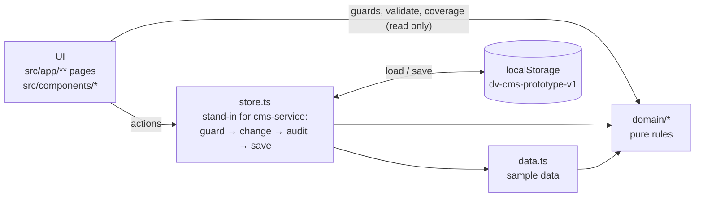

# Architecture

## Context

A single Next.js app that runs entirely in the browser. Every page is a client component; the build is static. There is no server code, no database and no network call after the page loads: the data is sample data kept in localStorage ([ADR 0002](adr/0002-fake-data-in-localstorage.md)). The purpose is to agree the Content Admin journey before the real CMS is built ([ADR 0001](adr/0001-prototype-before-building.md)).

## Layers

Arrows point from the code that imports to the code it uses. `src/lib/domain/` imports nothing outside itself; ESLint fails the build if it tries (`eslint.config.mjs`). The UI never changes data except through `act.*` in the store.

| Layer | Files | Job |
|---|---|---|
| Domain | `src/lib/domain/{content,localization,validation,publishing,access,audit}.ts` | The rules, as pure functions over plain objects. One file per bounded context ([context map](domain/context-map.md)). |
| Store | `src/lib/store.ts` | One function per future endpoint. Each checks the domain guard first and does nothing if refused (no change, no log), then applies the change to a copy, writes the audit entry, saves to localStorage and notifies React ([ADR 0005](adr/0005-guards-enforced-in-the-store.md)). Saved data with the wrong shape is replaced by fresh sample data. |
| Sample data | `src/lib/data.ts` | Four placeholder books and three stories, with problems planted on purpose so validation and promote have something to show. |
| UI | `src/app/(cms)/*/page.tsx`, `src/components/*` | Screens. They read the store with `useApp()` and call domain guards to disable controls and show the reason. `src/app/error.tsx` catches a screen that still fails and offers a reset. |

## Where each rule lives

| Rule | Function | File |
|---|---|---|
| Who may edit, approve, promote, switch | `blockEdit`, `blockSuper`, `blockToggle` | `access.ts` |
| A text edit makes that language's audio stale | `editChunkText` | `content.ts` |
| Audio draft → approve or reject | `applyAudio` | `content.ts` |
| Fixed media paths | `audioPath`, `nodes` (media base) | `content.ts` |
| Coverage, "started", fallback to English | `coverage`, `started`, `fallback` | `localization.ts` |
| What counts as an error or a warning | `validate`, `errorsIn` | `validation.ts` |
| Send for review, approve, delete draft | `blockSendForReview`, `blockApprove`, `blockDeleteDraft` | `publishing.ts` |
| Promote plan, promote, revert | `diff`, `promoteInto`, `revertPromote`, `blockPromote` | `publishing.ts` |
| Production switches | `blockSwitchOn`, `blockEnableLanguage` | `publishing.ts` |
| Append-only log | `record` | `audit.ts` |
| The 17 pre-promote checks (display) | `promoteChecks` | `src/app/(cms)/promote/checks.ts` |

The invariants each rule protects, and their tests, are listed in the [context map](domain/context-map.md#invariants).

## Data model in brief

An **Item** is a Book (epic: section → chapter → scene → chunk, plus a quiz per chapter) or a Story (scene → chunk). Text is a `LocalizedText` (`{ en, te, kn }`). Each chunk has audio per language and voice, in one of four states: current, draft, stale, missing. The database (`DB`) holds the staging and production item lists, the audit log, one snapshot per promoted item, and the theme and character catalogs. Staging and production items are linked by a `match` key; their children by an id prefix (`p-`), which is a prototype shortcut. The full model is in the [context map](domain/context-map.md#content-model) and the words in the [ubiquitous language](domain/ubiquitous-language.md).

## Screens

`/` sign-in (pick a role) · `/library` · `/edit` (tree, panels per node type, validation list, switches) · `/promote` (six-step wizard) · `/activity` · `/journeys` (starts each review journey) · `/wireframes` (low-fidelity drawings). The [screen inventory](ux/screen-inventory.md) and [information architecture](ux/information-architecture.md) describe them.

## From prototype to the real system

The real CMS is a separate repository: a React website and `cms-service`, writing directly to the staging and production Supabase databases and Cloudflare R2 ([ADR 0008](adr/0008-real-cms-shape.md)).

| Carries over | How |
|---|---|
| Journeys, screens, wording | The agreed UI flows, [journey maps](ux/journey-maps.md), [UX principles](ux/ux-principles.md). |
| Requirements and scenarios | [requirements.md](requirements.md) and `features/*.feature`, handed to the Gherkin owner as a starting set. |
| Domain rules | `src/lib/domain/` and `tests/` as a readable specification for the service. Reimplemented, not ported ([ADR 0003](adr/0003-domain-rules-as-pure-functions.md)). |
| API shape | The store's actions became the [draft OpenAPI contract](api/openapi.yaml). |

| Thrown away | Replaced by |
|---|---|
| `store.ts` and localStorage | cms-service, the two Supabase databases, R2. |
| Fake sign-in and role switcher | The Datta Vani login; the role is checked on the server. |
| Simulated audio (speech synthesis, fake timings, fake waveforms) | The real audio and transcript generation. |
| Simulated MFA, dry run and promote progress | Real checks against production, one transaction per promote. |
| `p-` id prefix for matching | A saved staging ↔ production mapping (requirements open question 7). |
| Sample books and stories | The real four books and their text. |
