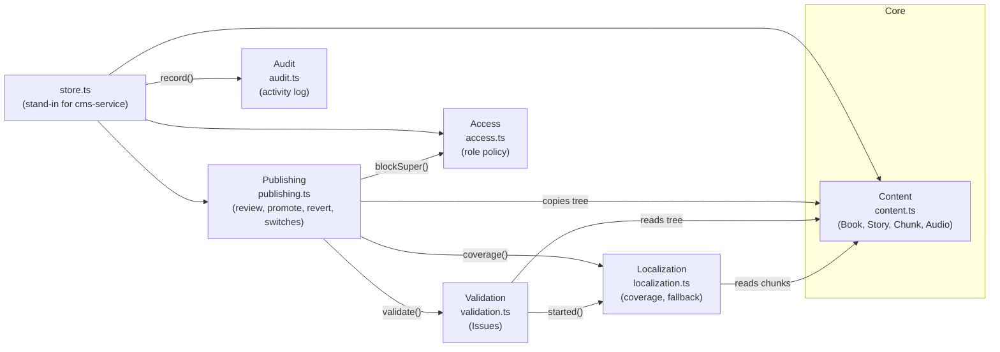
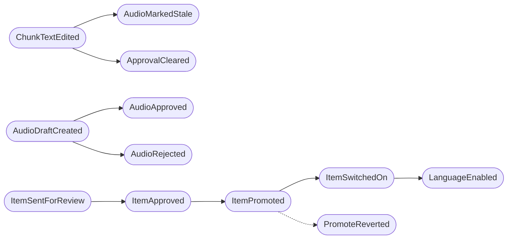
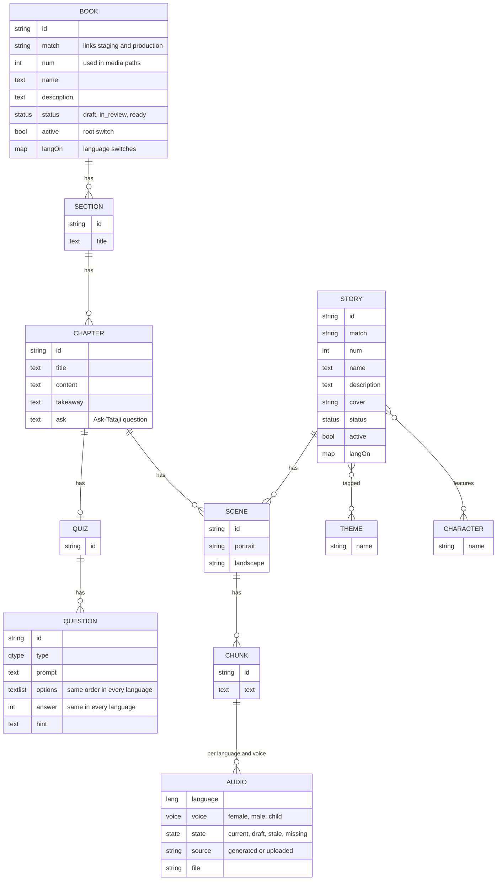

# Context map

The CMS rules are split into six small **bounded contexts**. Each one is a single file in `src/lib/domain/`. A context owns its words (see [ubiquitous-language.md](ubiquitous-language.md)) and its rules. Other contexts use it only through the functions it exports.

`src/lib/data.ts` and `store.ts` sit on top: sample data, and a fake "server" kept in localStorage. See [architecture](../architecture.md) for the layers.

## The contexts

An arrow means "uses". Nothing points back at Content: it is the core and depends on nobody.

| Context | File | What it owns | Main functions |
|---|---|---|---|
| **Content** | `content.ts` | The content tree and the rules for changing it | `nodes`, `findById`, `editChunkText`, `applyAudio`, `audioPath`, `wordTimings` |
| **Localization** | `localization.ts` | Languages, how complete each one is, fallback to English | `coverage`, `started`, `fallback`, `say` |
| **Validation** | `validation.ts` | The policy that turns an item into Issues | `validate`, `errorsIn` |
| **Publishing** | `publishing.ts` | Review status, the promote plan, promote, revert, root and language switches | `diff`, `promoteInto`, `revertPromote`, `blockPromote`, `blockApprove`, `blockSwitchOn`, `blockEnableLanguage` |
| **Access** | `access.ts` | Roles and what each may do | `blockEdit`, `blockSuper`, `blockToggle` |
| **Audit** | `audit.ts` | The append-only activity log | `record` |

Guards (`block…` functions) all work the same way: they return `null` when the action is allowed, or a short reason when it is not. The UI shows the reason on the disabled button. The service refuses the request with the same reason.

## Aggregates

An **aggregate** is a group of objects that is always changed together and saved together. Here there are two, and they are the two kinds of **Item**:

- **Book** (epic): Book → Section → Chapter → Scene → Chunk, and Chapter → Quiz → Question.
- **Story** (bedtime story): Story → Scene → Chunk.

Everything inside is reached through the item. Review, promote, revert and the switches always work on a whole item, never on part of one.

**Value objects** (no identity, compared by value): Localized text (`Text`), Audio asset (`Audio`), Media path (string from `audioPath`), Word timing.

## Invariants

These must always be true. Each has a unit test in `tests/` and a scenario in `features/`.

| # | Invariant | Where it is enforced | Test |
|---|---|---|---|
| I1 | Content is edited on staging only. | `blockEdit`, checked in `store.act.edit` | `access.test.ts`, `store.test.ts` |
| I2 | Changing a chunk's text in a language marks that language's current and draft audio out of date. Other languages are untouched. | `editChunkText` | `content.test.ts` |
| I3 | Audio approve and reject only work on a draft. Reject restores what was there before. | `applyAudio` | `content.test.ts` |
| I4 | The correct answer and option order of a question are the same in every language. | Data shape: one `options` list, one `answer` | — |
| I5 | Only a Super Admin approves, promotes, reverts, and switches things in production. | `blockSuper`, `blockToggle` | `access.test.ts`, `store.test.ts` |
| I6 | An item with errors in a language cannot be promoted in that language. English must always be included. Only approved items are promoted. | `blockPromote` | `publishing.test.ts` |
| I7 | Promote keeps production IDs. | `promoteInto` | `publishing.test.ts` |
| I8 | Promote never deletes anything in production. | `promoteInto` | `publishing.test.ts` |
| I9 | Promote never switches anything on. New items land switched off; existing items keep their switches. | `promoteInto` | `publishing.test.ts` |
| I10 | Languages not chosen for a promote keep their production values. | `promoteInto` | `publishing.test.ts` |
| I11 | Every promote saves a snapshot first. Revert restores it, or switches a new item off. Revert with nothing to undo does nothing. | `promoteInto`, `revertPromote` | `publishing.test.ts` |
| I12 | A language can be switched on in production only when it is complete (100% coverage, no errors). | `blockEnableLanguage` | `publishing.test.ts`, `store.test.ts` |
| I13 | An item can be switched on in production only when its English has no errors. | `blockSwitchOn` | `publishing.test.ts` |
| I14 | Every change is logged. The log is append-only. Refused actions are not logged. | `record`, `store` | `access.test.ts`, `store.test.ts` |

## Domain events

An event is "something that happened" that other parts may react to. The prototype does not have an event bus; the reaction happens in the same function. The real cms-service can publish these.

| Event | Raised when | Reaction |
|---|---|---|
| `ChunkTextEdited` | A chunk's text changes in one language | `AudioMarkedStale` for that language; `ApprovalCleared` if the item was approved; audit entry |
| `AudioMarkedStale` | Audio no longer matches its text | Validation reports an error (required voice) or warning (child) |
| `AudioDraftCreated` | Regenerate or upload | Transcript made as a draft; audit entry |
| `AudioApproved` / `AudioRejected` | A draft is accepted or thrown away | Coverage may change; audit entry |
| `ItemSentForReview` | Draft → In review | Audit entry |
| `ItemApproved` | In review → Approved | Promote becomes possible; audit entry |
| `ApprovalCleared` | An approved item is edited | Status back to Draft; audit entry |
| `ItemPromoted` | Promote finished | Snapshot saved; switches unchanged; audit entry |
| `PromoteReverted` | Revert finished | Audit entry |
| `ItemSwitchedOn` / `ItemSwitchedOff` | Root switch changed | Families see it (or not) after the cache refreshes (about 10 minutes); audit entry |
| `LanguageEnabled` / `LanguageDisabled` | A language switch changed | Families see that language (or English instead); audit entry |
| `StoryCreated` | A new bedtime story is added | Lands as a switched-off draft; audit entry |

## Content model

`text` means localized text: one value per language (`en`, `te`, `kn`).

How this is stored in the real database (side tables, a jsonb column, or parallel trees) is still an open question; see [requirements.md](../requirements.md#6-open-questions). The model above is the same either way.

## Simplifications in the prototype

- Staging and production children are matched by an id prefix (`p-`). The real CMS keeps a saved id mapping.
- Promote copies one item at a time and in memory. The real one runs a dry run and writes in a transaction.
- Snapshots keep only the last promote per item (one level of undo).
- Events are not published; the reactions run inline.
