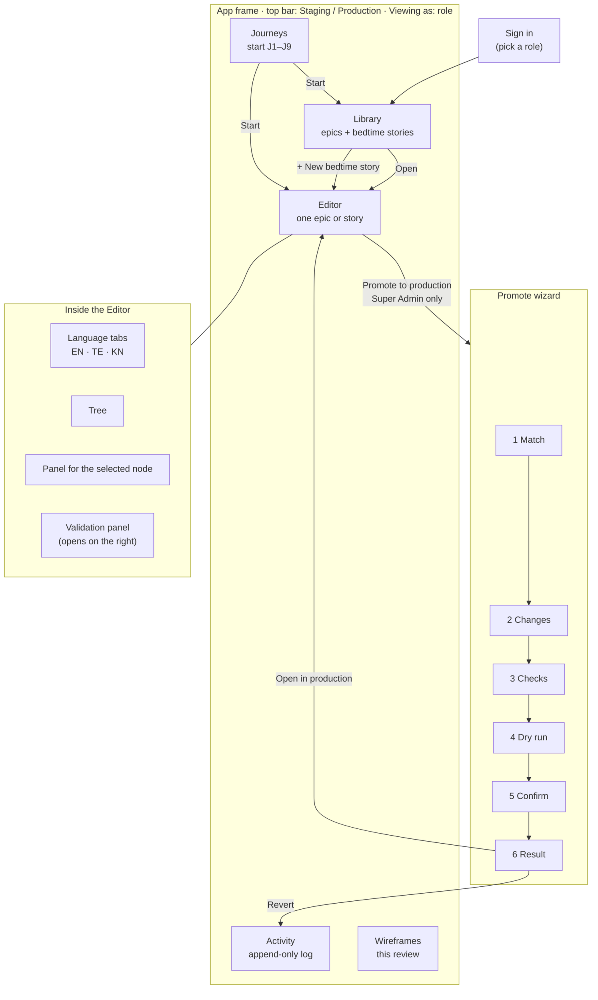
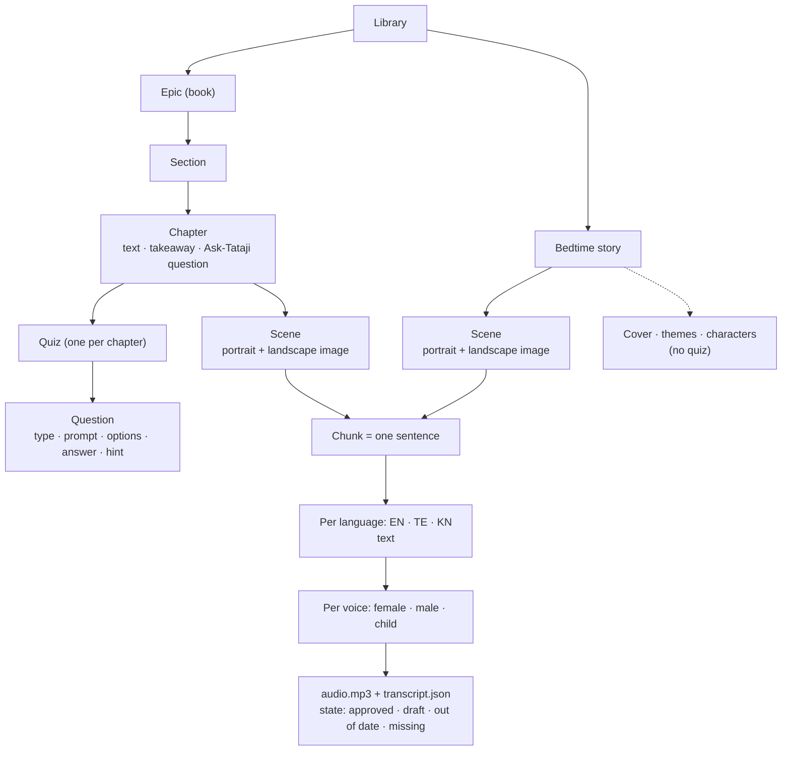
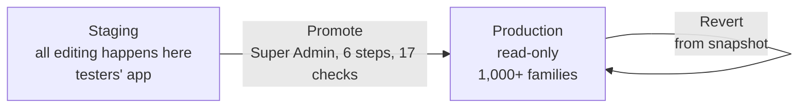

# Information architecture

Two pictures: how the **screens** are organised (site map), and how the **content** is organised (content hierarchy).
Both are Mermaid diagrams; GitHub and most Markdown viewers draw them.

## 1. Site map

Every screen sits under the same frame: a top bar (environment switch, role switch, reset, sign out) and a left menu.
The environment switch does not change the screens; it changes which database they show and whether editing is allowed.

### Editor panels by node type

| Node selected in the tree | Panel shows |
|---|---|
| Book (epic root) | Name, description, counts, media base path, on/off switch(es) |
| Story (bedtime story root) | Title, description, cover, themes, characters, scenes list |
| Section | Section title, chapters list |
| Chapter | Title, chapter text, key takeaway, Ask-Tataji question, scenes and quiz list |
| Scene | Portrait and landscape images, chunks list |
| Chunk | Sentence (with English source when translating), audio + transcript rows per voice |
| Quiz | Question list, then question type, prompt, options, correct answer, hint |

## 2. Content hierarchy

### Rules that come from this hierarchy

- **Text is per language; images are shared.** A scene's images are the same in every language (unless they contain words).
- **Audio is per language and per voice.** Each pair (audio + transcript) has its own state. Changing a chunk's text marks that language's pairs out of date.
- **Required voices:** female and male. Child is optional (a warning when missing, not an error). Still open for the team to confirm.
- **Quiz structure belongs to English.** Question type, number of options, option order and the correct answer are set in English; other languages translate the words only.
- **On/off lives at two levels in production:** the root (book or story) and each translated language. English is the fallback when a language is off.
- **Fixed file paths.** Every file lives at a path built from the item's base path, e.g. `content_media/epics/books/1/sections/…/chunks/2/te/body/female/audio.mp3`. The CMS shows the path; nobody types it.

## 3. Environments

- Content Managers edit staging only. Production is read-only for everyone except the Super Admin's promote, switch on and switch off.
- Promote never deletes and never switches anything on by itself. New items and new languages land switched off.
